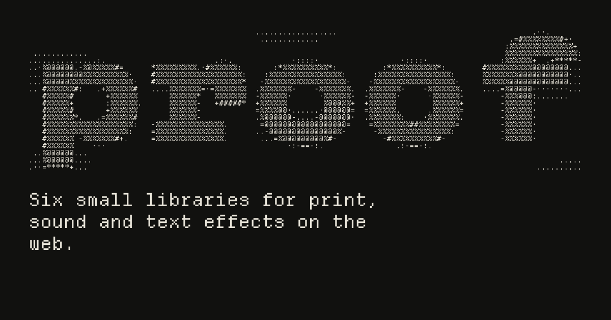
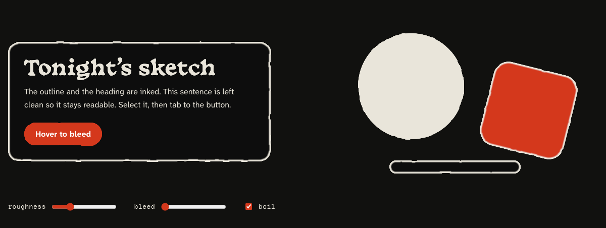
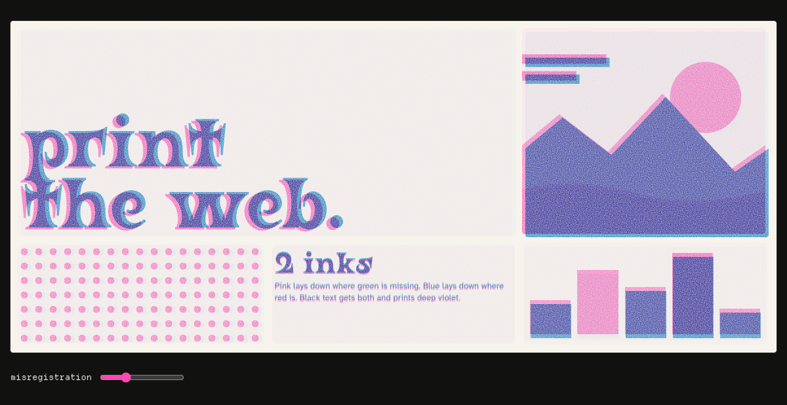
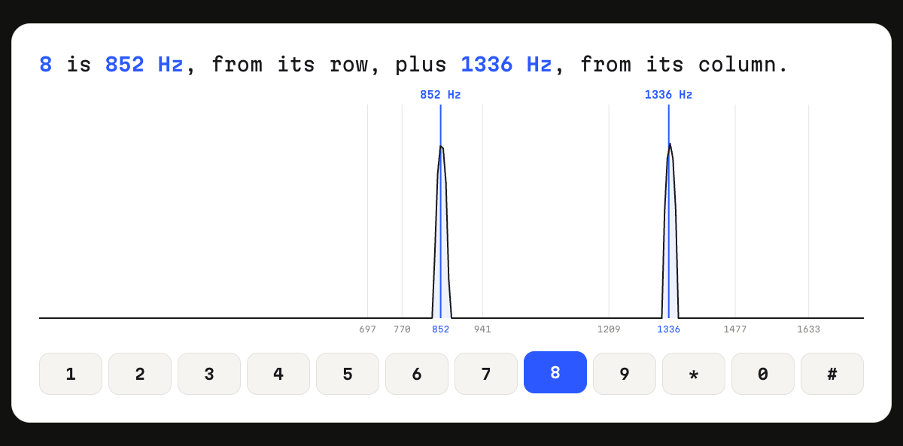
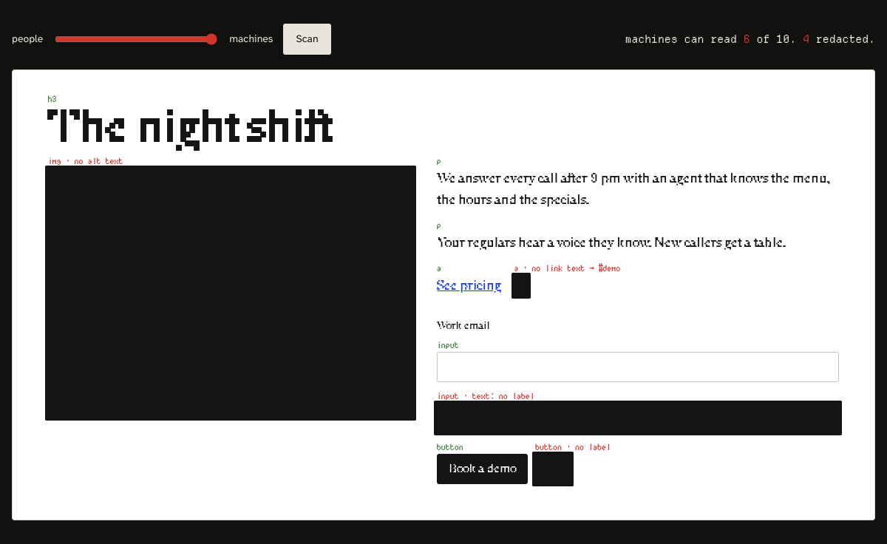
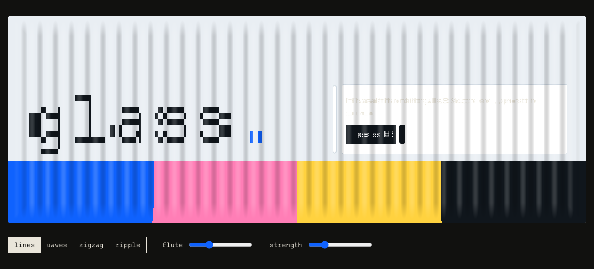
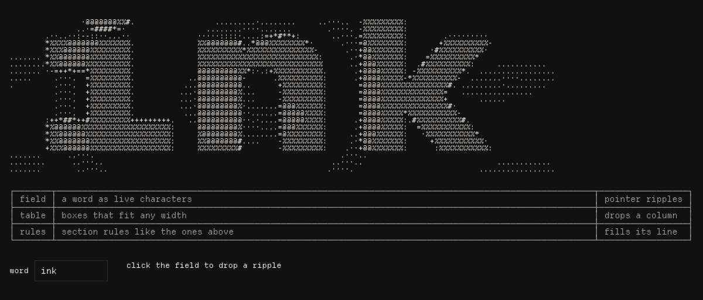

<p align="center"></p>

# proof

Six dependency-free JavaScript libraries for print, sound and ASCII effects on real HTML. Each library is one ES module. Copy the file into your project, import it, and the code is yours.

Effects apply to the live page, mostly through SVG filters and the Web Audio API. Text stays selectable, and crawlers and screen readers can still read the page.

## Libraries

### ink: hand-drawn edges for any element

Borders, shapes and headings get a brush-drawn edge that redraws a few times a second, like hand-drawn animation. Ink bleeds on hover.



### riso: two-color print look for any element

Splits an element into two fluorescent inks with slight misregistration and paper grain, like a risograph print. Works on text, images and CSS shapes.



### dial: touch-tone audio with a live spectrum

Plays the two tones a phone sends for each key, decodes them back out of the audio, and draws them on a live spectrum.



### readback: see a page the way machines read it

Lists what a crawler or screen reader gets from any part of a page, in reading order. Images without alt text, unnamed links and buttons, and unlabeled fields are flagged.



### reed: fluted glass over live HTML

Fluted, wavy or ripple glass over real HTML. Text stays selectable, buttons stay clickable, and there is no WebGL.



### ascii: live ASCII text, tables and rules

Renders a word as an animated field of characters that ripples where you click, plus box-drawing tables and section rules that fit any width.



## Use a library

Copy the file from [`src/lib`](src/lib) into your project and import it:

```js
import { ink } from './ink.js'

ink(document.querySelector('.card'), { rough: 3 })
```

Each library's docs page has a live demo, the full API and browser notes.

## Work on the site

The docs site is an [Astro](https://astro.build) static build. It needs [Bun](https://bun.sh).

```sh
bun install
bun run dev      # local site at http://localhost:4747
bun run build    # static output in dist/
bun run check    # type check
```

`src/data/libraries.js` is the single list behind every page, the search index, `/llms.txt` and the `/r/<file>.js` downloads. To add a library, add its file to `src/lib`, a record to that list and a demo to `src/components/demos`.

## Check the pages

`scripts/check-pages.mjs` loads every route in Chromium, Firefox and WebKit. It fails on page errors, failed loads, sideways scroll at phone width, and broken core flows (dial, search, install, downloads, theme, readback, the ascii animation loop).

```sh
bunx playwright install chromium firefox webkit
bun run build
bun run preview      # serves dist/ at http://localhost:4747 in the background
bun run check:pages
bunx astro preview stop
```

While the preview runs, `node scripts/make-readme-shots.mjs` refreshes the images in this README, and `node scripts/make-og.mjs` refreshes the share image.

## License

MIT, by [Alok Ranjan](https://alokranjan.me). Fonts are under the SIL Open Font License. Their licenses are in `public/fonts`.
